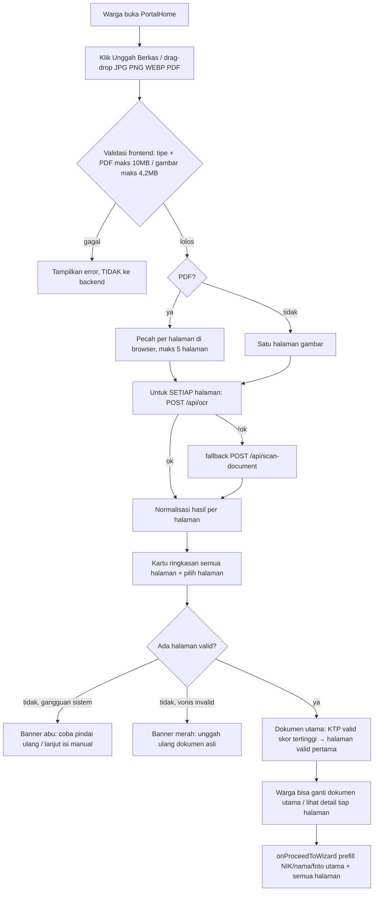

# Alur Website AIPEX VeriBot Kelurahan Sukamaju (Existing, Hasil Audit Kode)

> Sumber: `src/App.tsx`, `src/components/*`, `src/data/servicesData.ts`, `src/types.ts`, `api/*.ts`, `api/_lib/*`, `server.ts`, `vercel.json`. Dokumen ini memetakan website yang sudah di-build apa adanya, sebelum fitur anti-spam dikerjakan.

## 1. Ringkasan Sistem

AIPEX VeriBot adalah portal layanan kependudukan Kelurahan Sukamaju (React 19 + Vite + Tailwind + Express dev + Vercel Serverless + Supabase + Gemini/Nara Route AI).

Prinsip utama:

- **Warga tanpa login:** semua pra-pemeriksaan, wizard, dan lacak tiket terbuka agar 1-klik.
- **Petugas dengan username + password:** `OfficerLoginModal.tsx` + `POST /api/admin/login`. Password di-hash scrypt, access JWT 8 jam, refresh token di cookie HttpOnly. Kode akses lama dan fallback offline sudah dihapus. Detail: [`docs/AUTH-PETUGAS.md`](./AUTH-PETUGAS.md).
- **UU PDP:** foto KTP/KK hanya diproses di RAM (multer memory / Buffer serverless), auto-purge, tidak disimpan ke disk. Yang disimpan hanya teks: NIK, nama, skor, status, catatan.
- **AI ganda:** Nara Route (`https://router.bynara.id/v1`) prioritas untuk gambar non-PDF, Gemini (`gemini-2.5-flash`, `gemini-3.6-flash`) sebagai fallback/default. Chat FAQ juga punya knowledge-base offline agar tetap jawab walau AI mati.

## 2. Peta Navigasi (Frontend `App.tsx`)

State `currentView`: `portal | wizard | login | officer`.

```text
Header (portal/wizard/login/officer, badge pendingCount, menu Login Petugas)
  -> portal (default): PortalHome
  -> wizard: InteractiveWizard (4 langkah)
  -> login (modal): OfficerLoginModal -> sukses -> officer
  -> officer: AdminDashboard / OfficerDashboard -> logout -> portal
Footer + TicketStatusModal (global) + FloatingVeriBot (global, pojok kanan bawah)
```

Navigasi header: `Beranda/Katalog (portalView)`, `Cek Tiket QR (lacakSection)`, `Alur Layanan (alurLayanan)`, `Bantuan & FAQ (faqSection)`.

## 3. Alur Warga — Jalur Cepat (Pra-Pemeriksaan di Beranda)

Lokasi: `PortalHome.tsx` section `simulasiSection` → `OcrPreScreenCard.tsx`.



Catatan penting:

- `OcrPreScreenCard` punya race-guard (`scanIdRef`) agar hanya hasil terbaru tampil.
- PDF **tidak dikirim utuh**: file dipecah di browser (`pdfSplitter.ts`), lalu satu halaman = satu request = satu kuota OCR. PDF 3 halaman = 3 panggilan.
- Jenis dokumen dinilai per halaman, bukan per PDF. Halaman `TIDAK_VALID`/gangguan sistem tidak memblokir halaman lain.
- Tombol lanjut memakai status **dokumen utama**, bukan halaman yang sedang dilihat. Halaman lain boleh invalid selama dokumen utama valid.
- NIK parsial (`nik_partial`, mis. 12/16 digit) ditampilkan sebagai info, tapi tidak diteruskan ke wizard (wizard butuh 16 digit utuh).
- PDF tidak ada preview ``, hanya placeholder ikon berkas per halaman.
- Gangguan AI/koneksi/kuota (`systemError`) dibedakan dari vonis “bukan dokumen kependudukan”. Halaman yang sudah selesai tetap ditampilkan bila pindaian berhenti di tengah PDF.
- Detail batas, pemetaan, dan uji manual: [`docs/OCR-MULTI-HALAMAN.md`](./OCR-MULTI-HALAMAN.md).

## 4. Alur Warga — Wizard 4 Langkah (Jalur Resmi + QR)

Lokasi: `InteractiveWizard.tsx`. Bisa dibuka dari katalog layanan atau dari hasil pra-pemeriksaan (dengan prefill).

### Step 1 — Data Diri

- Input: `jenis layanan` (8 pilihan dari `servicesData.ts`), `NIK 16 digit`, `nama`, `WA`, `alamat`.
- Validasi: NIK/nama/WA wajib, NIK harus 16 digit angka. Ada preset `Data Lengkap & Jelas` / `Berkas Agak Buram` untuk uji coba.
- NIK/nama diisi dari dokumen utama hasil OCR. Nilai yang sudah diketik manual tidak ditimpa saat pemetaan berubah. Peringatan konteks muncul untuk KK/akta (data bisa milik kepala keluarga, anak, pasangan, atau almarhum).
- **Akta kematian:** NIK/nama almarhum tidak pernah diisikan otomatis sebagai pemohon; isi data pemohon (keluarga) manual.

### Step 2 — Upload Berkas (sesuai syarat WAJIB layanan)

- Slot upload = daftar `requirements` bertanda `mandatory` di `servicesData.ts` untuk layanan terpilih (mis. KTP: KTP lama/surat hilang + KK + Akta Kelahiran).
- Slot 1 = dokumen utama (`docImageBase64`, dipindai AI di Step 3; terisi otomatis dari pra-pemeriksaan/preset). Slot 2..N = berkas pendukung (`supportFiles`, dilampirkan untuk verifikasi loket + tercatat di `catatan_ai` tiket).
- **PDF multi-halaman dari pra-pemeriksaan:** panel “Pemetaan N halaman dokumen” menampilkan setiap halaman dan slotnya. Warga bisa mengubah dokumen utama, memindahkan halaman ke lampiran, atau menandai “Tidak dipakai”. Halaman invalid tidak bisa dipetakan.
- Ganti layanan di Step 1: bila ada hasil OCR multi-halaman, halaman **dipetakan ulang otomatis tanpa memindai ulang**; bila tidak ada, seluruh upload di-reset seperti sebelumnya.
- Mengganti/menghapus berkas manual akan melepas pemetaan otomatis agar tidak ada slot basi. Jika ada slot kosong → alert blokir menyebut judul syarat yang kurang. Ada info UU PDP in-memory auto-purge.

### Step 3 — Scanner AI

- `POST /api/scan-document { imageBase64 (dokumen utama), lampiran: [...nama berkas pendukung], serviceType, inputNama, inputNik }` dengan progress bar animasi.
- Normalisasi frontend `jenis_dokumen` → `KTP/KK/AKTA/LAINNYA`, `status_verifikasi` → `BERHASIL/BURAM/TIDAK_VALID`.
- Hasil:
  - `LULUS` (BERHASIL): banner hijau + skor (mis. 92%) + tabel OCR vs formulir.
  - `GAGAL valid` (BURAM): banner kuning, tetap bisa lanjut (QR REVISI).
  - `LAINNYA/TIDAK_VALID`: banner merah `BUKAN_KTP_MESSAGE`, tombol Generate Tiket diblokir.
  - `Gagal jaringan`: pesan koneksi, dibedakan dari vonis bukan KTP.

### Step 4 — Tiket QR

- `POST /api/tickets { nik, nama_warga, phone, alamat, jenis_dokumen, skor_ai, status_ai, catatan_ai, scan_jenis_dokumen, scan_status_verifikasi, verification{...} }`.
- Backend (`api/tickets.ts`, `server.ts`) validasi ganda: NIK 16 digit + bukti scan harus ada + tolak jika `LAINNYA/TIDAK_VALID`. Jika lolos:
  - Buat `ticketCode TKT-YYYYMM-XXXX`, mask NIK (`6 digit******4 digit`), status awal `PENDING` (BERHASIL) atau `REVISI` (BURAM).
  - Simpan ke Supabase `tickets` + in-memory, return `201`.
- Frontend tampilkan QR canvas (teks rapi via `buildTicketQrText` di `src/lib/ticketQr.ts`: kop + kode + nama + NIK mask + layanan + skor + status + waktu terbit), confetti, simpan ke state `tickets` via `onTicketCreated`.

## 5. Alur Warga — Jalur Alternatif `DocumentScanner`

Lokasi: `DocumentScanner.tsx` (varian scanner dengan tiket langsung).

- Upload via `FormData(file)` → `POST /api/ocr` → fallback `/api/scan-document`.
- Jika dokumen valid (BERHASIL/BURAM) dan backend mengembalikan `ticket`, langsung tampilkan kartu tiket hitam + QR (`qrcode.react`).
- Jika backend tidak kirim tiket (mis. Supabase gangguan) tapi dokumen valid, buat tiket fallback lokal `TKT-<timestamp>` agar warga tetap dapat QR dan verifikasi manual di loket.
- Ada fitur koreksi NIK manual 16 digit jika AI gagal baca NIK tapi jenis dokumen sudah benar.

## 6. Alur Lacak Tiket (Warga)

- Input di `PortalHome` (`lacakSection`) atau tombol katalog → `App.handleCheckTicket(code)` → `GET /api/tickets/:kode_tiket`.
- **Pindai QR publik:** tombol `Scan QR` di samping kolom kode membuka `QrScanModal` (kamera belakang, dimuat malas agar bundle awal tetap ringan). QR tiket tetap berupa teks `TKT-...`, sehingga kartu yang sudah dicetak tetap terbaca tanpa jaringan. Jika kamera ditolak/tidak ada, warga diarahkan mengetik kode manual.
- Backend cari di Supabase (`ilike kode_tiket`) lalu fallback memori. Mapping status publik: `BERHASIL→MENUNGGU`, `BURAM→REVISI`, `PENDING→MENUNGGU`, keputusan petugas tetap `DISETUJUI/DITOLAK/PERLU_PERBAIKAN`. Tambahkan `skor_kejelasan`, `nama`, `catatan`.
- **Riwayat status (timeline):** respons menyertakan `riwayat[]` opsional dari `verification_logs` (status, waktu, catatan). Hanya status, waktu, dan catatan yang dikirim — tanpa `officer_id`, log rollback WA, atau penanda purge foto. Tiket lama tanpa log tetap menampilkan langkah "Tiket diterbitkan".
- **Riwayat lokal perangkat:** maksimal 5 tiket, TTL 30 hari, disimpan di `localStorage` (`aipex_ticket_history_v1`). Hanya kode, layanan, dan tanggal — NIK, nama, HP, alamat, dan foto tidak pernah disimpan. Tombol `Hapus` membersihkan riwayat.
- Sukses → `TicketStatusModal` tampil (termasuk timeline). Gagal → alert "tidak ditemukan". Contoh seed: `TKT-202609-8410`, `TKT-202508-001`.

## 7. Alur Katalog & Syarat Layanan

Sumber: `src/data/servicesData.ts` (8 layanan):

1. Penerbitan KTP-EL Baru/Penggantian (`identitas`)
2. Kartu Identitas Anak KIA (`identitas`)
3. Aktivasi Identitas Digital IKD (`identitas`)
4. Akta Kematian (`sipil`)
5. Akta Perkawinan (`sipil`)
6. Surat Pindah SKPWNI (`perpindahan`)
7. Konsolidasi/Sinkronisasi NIK (`perpindahan`)
8. Surat Keterangan Usaha SKU (`perpindahan`)

- `PortalHome` punya search + filter kategori + kartu seragam. Tombol `Syarat` → `RequirementModal` (daftar mandatory/opsional). Tombol `Pilih Layanan` → buka Wizard dengan layanan terpilih.

## 8. Alur Petugas (Login + Dashboard)

```mermaid
flowchart TD
  A[Header Klik Login Petugas] --> B[OfficerLoginModal input username + password]
  B --> C[POST /api/admin/login {username, password}]
  C -- sukses, wajib ganti password --> D[Form ganti password]
  D -- sukses --> E[Login ulang dengan password baru]
  C -- sukses --> F[View officer; access token di memori + cookie refresh HttpOnly]
  E --> F
  C -- gagal --> G[Pesan generik: username atau password salah]
  F --> H[AdminDashboard: daftar tiket, filter status + layanan + umur tunggu]
  H --> I[1-klik APPROVED / REJECTED / REVISI + catatan_petugas]
  I --> J[PATCH /api/admin/tickets]
  J --> K[Status terupdate + warga bisa lacak ulang]
```

Filter dashboard petugas:

- **Status:** tombol cepat `SEMUA/PENDING/MENUNGGU/BERHASIL/DISETUJUI/DITOLAK/BURAM/PERLU_PERBAIKAN`.
- **Layanan:** dropdown dari nilai unik `jenis_dokumen` yang benar-benar ada di data (bukan daftar hard-code), sehingga layanan lama tetap bisa disaring.
- **Umur tunggu:** hanya berlaku untuk tiket yang masih pending (`Menunggu > 1/2/7 hari`). Tiket pending berumur ≥ 2 hari otomatis diberi badge `Menunggu N hari` di tabel dan kartu mobile.
- **Reset** mengembalikan pencarian, status, layanan, dan umur ke default. Jumlah hasil selalu ditampilkan (`Menampilkan X dari Y tiket`).

Saat halaman di-reload, access token di memori hilang dan frontend memanggil
`POST /api/admin/refresh` memakai cookie `aipex_refresh` (HttpOnly). Logout dan
ganti password mencabut sesi refresh. Kode tiket `TKT-...` bukan kredensial
petugas dan tidak bisa dipakai untuk login.

## 9. Alur Chatbot VeriBot (24 Jam)

Lokasi: `FloatingVeriBot.tsx` (bubble 1:1 pojok kanan bawah) → `POST /api/chat-faq {message}`.

Urutan backend (`api/chat-faq.ts`, `server.ts`):

1. Coba Nara Route chat jika dikonfigurasi.
2. Coba Gemini `gemini-3.6-flash` → fallback `gemini-2.5-flash`.
3. Fallback offline `getOfflineFaqAnswer` (jam loket, syarat KTP hilang/rusak/baru, KIA, KK, akta, RT/RW Perpres 96/2018, PDP, alamat/kontak).
4. Emergency fallback statis jika semua error (tetap `success:true` agar chat tidak mati).

Quick chips: Jam Loket, Syarat KTP Hilang, Fast-Track, link Testimoni Google Form.

## 10. Arsitektur API & Data (Vercel)

`vercel.json`: framework Vite, output `dist`, rewrite `/api/:path*` ke functions, `maxDuration 60s` untuk OCR, `30s` untuk chat.

| Method + Path | Handler | Fungsi |
|---|---|---|
| `GET /api/health` | `api/health.ts` | Status + compliance UU PDP |
| `GET /api/providers` | `api/providers.ts` | Daftar AI provider tanpa bocor key |
| `POST /api/ocr`, `POST /api/scan-document` | `api/ocr.ts`, `api/scan-document.ts` → `_lib/ocr-handler.ts` | OCR Vision + buat tiket otomatis jika valid |
| `GET /api/tickets`, `POST /api/tickets` | `api/tickets.ts` | List + buat tiket wizard (dengan bukti scan) |
| `GET /api/tickets/:kode` | `api/tickets/[id].ts` | Lacak 1 tiket + `riwayat[]` publik (tanpa identitas petugas) |
| `POST /api/chat-faq` | `api/chat-faq.ts` | Chatbot FAQ |
| `POST /api/admin/login`, `GET/PATCH /api/admin/tickets` | `api/admin/*`, `api/officer/*` | Auth petugas + kelola tiket |
| Lokal dev `npm run dev` | `server.ts` (tsx Express + Vite middleware, multer memory 10MB) | Mirror logic yang sama untuk dev |

Skema Supabase `tickets` (dari payload): `kode_tiket, nik, nama, jenis_dokumen, skor_kejelasan, status_verifikasi (BERHASIL/BURAM), catatan, created_at`. Frontend mapping ke `Ticket { ticket_code, nik_encrypted, nama_warga, status_verifikasi: PENDING/APPROVED/REVISI/REJECTED, skor_ai, status_ai: LULUS/GAGAL }`.

## 11. Titik Spam (Untuk PRD Anti-Spam)

1. `POST /api/ocr` + `/api/scan-document` menerima JSON `imageBase64` tanpa auth → vektor utama pemborosan token.
2. `POST /api/chat-faq` menerima teks bebas tanpa auth → vektor sekunder.
3. `POST /api/tickets` sudah lebih aman (wajib bukti scan + NIK 16 digit), tapi tetap perlu rate-limit agar tidak banjir tiket.
4. Tidak ada beda perlakuan IP/bot vs warga di kode existing. Semua request langsung ke AI.

Lihat `docs/PRD-ANTI-SPAM-UPLOAD-AIPEX.md` untuk rencana penanganannya (rate-limit 5x/10min/IP di Redis, filter murah, cache hash; Turnstile adaptif NONAKTIF by policy).
