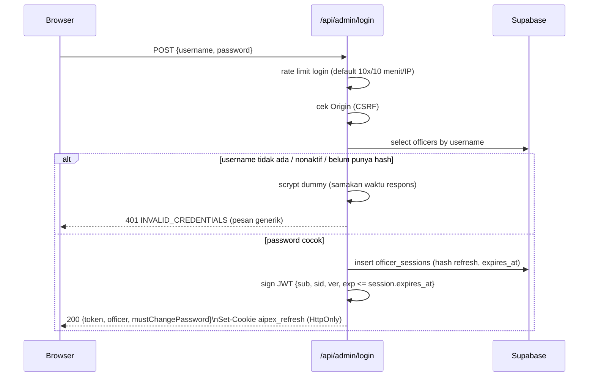

# Autentikasi Petugas AIPEX VeriBot

> **Status:** Opsi B — login `username` + `password`, hash **scrypt**, access **JWT HS256 8 jam**, refresh token di cookie **HttpOnly**, sesi yang bisa dicabut.
> **File migrasi:** `supabase/migrations/20261026_officer_auth_hardening.sql`
> **Kode utama:** `api/_lib/officer-service.ts`, `api/_lib/officer-http.ts`, `api/_lib/officer-auth.ts`, `api/_lib/password.ts`, `src/lib/officerAuth.ts`

Dokumen ini adalah panduan operasional sekaligus catatan desain. Jangan menempelkan
`OFFICER_JWT_SECRET`, service role key, password petugas, atau isi `.env.local` ke
chat, issue, commit, atau screenshot.

---

## 1. Ringkasan

Sebelumnya petugas login memakai **kode akses hardcoded** yang ikut tersimpan di
kode sumber. Kode tersebut sudah dihapus dari backend. Login sekarang **wajib**
lewat tabel `officers` di Supabase:

| Komponen | Sebelum | Sesudah (Opsi B) |
|---|---|---|
| Kredensial | kode akses statis | `username` + `password` per petugas |
| Password | tidak ada | hash **scrypt** (`N=32768, r=8, p=1`, salt 16 byte) |
| Access token | JWT dari kode akses | JWT HS256, default **8 jam** |
| Refresh | tidak ada | token acak 32 byte di cookie `HttpOnly` |
| Penyimpanan refresh | tidak ada | hanya **SHA-256(token)** di `officer_sessions` |
| Logout | hapus token di browser | cabut sesi refresh + hapus cookie |
| Ganti password | tidak ada | wajib saat login pertama; mencabut semua sesi |
| Fallback offline | ada | **dihapus** — gagal DB = gagal login (fail-closed) |

Tujuan desain:

1. Kode akses tidak lagi menjadi rahasia bersama yang bocor lewat repository.
2. Setiap petugas punya identitas dan password sendiri.
3. Access token tidak disimpan di `localStorage`, sehingga lebih tahan XSS.
4. Sesi bisa dicabut saat logout, ganti password, atau akun dinonaktifkan.
5. Perilaku server lokal (`server.ts`) dan Vercel Functions sama karena memakai
   handler yang sama (`api/_lib/officer-http.ts`).

---

## 2. Alur Autentikasi

### 2.1 Login



Catatan:

- Username dinormalisasi `trim().toLowerCase()` dan harus cocok dengan
  `^[a-z0-9][a-z0-9._-]{2,63}$`.
- Pesan gagal selalu **“Username atau password salah.”** agar tidak membocorkan
  apakah username terdaftar.
- `must_change_password=true` membuat frontend menahan dashboard dan meminta
  password baru terlebih dahulu.
- Login berhasil mencatat `last_login_at` dan audit `officer_login_logs`
  (hash username, hash IP, user-agent; **bukan** password/token).

### 2.2 Refresh saat halaman dibuka ulang

Access token hanya hidup di memori JavaScript (`src/lib/officerAuth.ts`). Saat
halaman di-reload, modul kehilangan token lalu memanggil:

```text
POST /api/admin/refresh
Cookie: aipex_refresh=<token acak>
```

Server:

1. Mencari sesi berdasarkan **SHA-256(token)**.
2. Menolak bila sesi tidak ada, sudah dicabut, atau `expires_at` lewat.
3. Memastikan petugas masih aktif dan masih punya `password_hash`.
4. Merotasi refresh token: hash lama diganti hash baru.
5. Menerbitkan access JWT baru dengan `exp` **tidak melewati** `expires_at` sesi.
6. Mengirim cookie baru dan access token baru.

Konsekuensi penting: **refresh tidak memperpanjang sesi tanpa batas**. Sesi
refresh berumur absolut 8 jam (default). Refresh di menit ke-7 hanya memberi
access token yang berlaku sampai menit ke-8.

### 2.3 Logout

`POST /api/admin/logout` membaca cookie, menandai `revoked_at` pada sesi yang
cocok, lalu menghapus cookie. Frontend juga menghapus profil dari memori dan
`localStorage`. Logout tetap mengembalikan sukses bila cookie sudah tidak ada.

### 2.4 Ganti password

`POST /api/admin/change-password` wajib Bearer access token:

1. Verifikasi password lama dengan scrypt.
2. Tolak bila password baru sama dengan password lama.
3. Validasi kebijakan password (minimal 12 karakter, huruf + angka, tidak
   mengandung username).
4. Simpan hash baru, `must_change_password=false`, `password_changed_at=now()`.
5. Naikkan `token_version`.
6. Cabut **semua** sesi refresh petugas tersebut.
7. Hapus cookie refresh; petugas login ulang dengan password baru.

Ada dua tempat di frontend:

- `OfficerLoginModal.tsx` — langkah wajib setelah login dengan password sementara.
- `AdminDashboard.tsx` — panel `ForcePasswordChangePanel` bila sesi hasil refresh
  masih menandai `mustChangePassword=true`.

---

## 3. Skema Database

Migrasi: `supabase/migrations/20261026_officer_auth_hardening.sql`.

### 3.1 Kolom baru pada `public.officers`

| Kolom | Tipe | Default | Keterangan |
|---|---|---|---|
| `username` | `text` | `null` | lowercase, unik secara case-insensitive |
| `password_hash` | `text` | `null` | format `scrypt$N$r$p$salt$hash` (base64url) |
| `must_change_password` | `boolean` | `true` | wajib ganti password setelah login |
| `is_active` | `boolean` | `true` | `false` = login & refresh ditolak |
| `token_version` | `integer` | `0` | dinaikkan saat ganti password |
| `password_changed_at` | `timestamptz` | `null` | jejak audit |
| `last_login_at` | `timestamptz` | `null` | diisi best-effort saat login |

Unique index: `officers_username_lower_uidx` pada `lower(username)`.

### 3.2 Tabel `public.officer_sessions`

| Kolom | Tipe | Keterangan |
|---|---|---|
| `id` | `uuid` PK | ID sesi; masuk ke klaim `sid` JWT |
| `officer_id` | `text` | sengaja `text` agar kompatibel UUID/text lama |
| `refresh_hash` | `text` unik | SHA-256 token refresh; token mentah tidak disimpan |
| `created_at` | `timestamptz` | waktu dibuat |
| `last_used_at` | `timestamptz` | waktu refresh terakhir |
| `expires_at` | `timestamptz` | batas absolut sesi |
| `revoked_at` | `timestamptz` | diisi saat logout/ganti password/dicabut manual |
| `ip_hash` | `text` | hash IP + user-agent, bukan IP mentah |
| `user_agent` | `text` | maksimal 300 karakter |

Index: `refresh_hash` unik, `(officer_id, expires_at desc)`, dan partial index
`expires_at` untuk sesi aktif.

### 3.3 Tabel `public.officer_login_logs`

Audit best-effort: `officer_id`, `username_hash`, `success`, `reason`, `ip_hash`,
`user_agent`, `created_at`. Tidak pernah menyimpan password, token, atau kode akses.

### 3.4 Kolom lama `kode_akses`

Kolom ini **tidak dipakai lagi** oleh kode baru. Migrasi:

- membiarkan kolom tetap ada agar akun lama tidak langsung kehilangan data;
- menghapus constraint `NOT NULL` agar akun baru tidak wajib mengisi kode akses;
- menambahkan komentar `DEPRECATED`.

Setelah semua petugas punya akun username/password, kolom boleh dihapus manual:

```sql
-- Jalankan hanya setelah yakin semua akun sudah dimigrasikan dan diuji.
alter table public.officers drop column if exists kode_akses;
```

> Jangan menghapus kolom sebelum migrasi akun selesai. Seed lama
> `20260925_seed_officers.sql` masih menyebut kolom tersebut untuk database baru.

---

## 4. Konfigurasi Environment

Semua nilai di bawah **server-only**. Jangan memakai prefix `NEXT_PUBLIC_` untuk
service role atau secret.

| Variabel | Wajib | Default | Keterangan |
|---|---:|---|---|
| `SUPABASE_URL` | ya | — | boleh berakhiran `/rest/v1`; kode menormalkannya |
| `SUPABASE_SERVICE_ROLE_KEY` | disarankan | — | secret server; bypass RLS |
| `SUPABASE_KEY` | alternatif | — | nama lama; isi dengan secret/server key |
| `OFFICER_JWT_SECRET` | ya | — | minimal 32 karakter; HMAC HS256 |
| `OFFICER_ACCESS_TTL_MS` | tidak | `28800000` (8 jam) | umur access JWT; min 1 menit, maks 30 hari |
| `OFFICER_SESSION_TTL_MS` | tidak | `28800000` (8 jam) | umur absolut sesi refresh; min 1 menit, maks 30 hari |
| `OFFICER_LOGIN_MAX` | tidak | `10` | maksimum percobaan login per IP per jendela; 1–1000 |
| `OFFICER_LOGIN_WINDOW_MS` | tidak | `600000` (10 menit) | panjang jendela rate limit login; 1000–86400000 ms |
| `APP_ORIGIN` | produksi | — | origin frontend, mis. `https://aipex.example.id`; boleh dipisah koma |
| `ADMIN_ORIGIN` | tidak | — | origin admin tambahan; boleh dipisah koma |
| `FORCE_SECURE_COOKIES` | tidak | `false` | `true` bila HTTPS non-production (mis. tunnel) |
| `UPSTASH_REDIS_REST_URL` + `UPSTASH_REDIS_REST_TOKEN` | tidak | — | rate limit terdistribusi; tanpa ini fallback memori |

Membuat secret JWT (jalankan di terminal sendiri, **jangan tempel hasilnya ke chat):

```bash
node -e "console.log(require('crypto').randomBytes(32).toString('hex'))"
```

Catatan:

- `Secure` pada cookie otomatis aktif bila `NODE_ENV=production`,
  `VERCEL_ENV=production`, atau `FORCE_SECURE_COOKIES=true`.
- `APP_ORIGIN` kosong berarti server hanya mengizinkan origin yang sama
  (berdasarkan `Host`/`x-forwarded-host`). Ini aman untuk deployment
  satu-domain, tetapi isi `APP_ORIGIN` bila frontend dan API berbeda origin.
- Perubahan env memerlukan restart server lokal atau redeploy Vercel.

### 4.1 Mode demo publik (sementara)

Untuk demo dengan banyak pengunjung, rate limit login bisa dilonggarkan agar
salah ketik password tidak langsung mengunci satu IP:

```dotenv
OFFICER_LOGIN_MAX=30
OFFICER_LOGIN_WINDOW_MS=10000
```

Artinya **30 percobaan login / 10 detik / IP**. Setelah demo selesai, hapus kedua
variabel (atau kembalikan ke `10` dan `600000`), lalu restart/redeploy.
`GET /api/health` menampilkan konfigurasi yang sedang aktif di
`adminAuth.loginRateLimit`.

Catatan:

- Semua percobaan login dihitung, bukan hanya password yang salah.
- Pengguna di balik NAT/Wi-Fi yang sama berbagi kuota IP.
- Jangan mematikan rate limit login total meskipun demo bersifat publik.
- Refresh (120/10 menit) dan ganti password (10/10 menit) tidak ikut berubah.
- Nilai env yang rusak atau di luar batas aman diabaikan dan kembali ke default
  produksi; login tidak pernah menjadi tanpa batas karena salah ketik env.

---

## 5. Langkah Penerapan (Go-Live)

> Urutan ini penting. Jangan membuat akun sebelum migrasi; sebaliknya, jangan
> mengaktifkan login baru sebelum akun petugas dibuat.

### Langkah 0 — Backup

Buat snapshot/backup database Supabase. Catat waktu dan simpan di tempat aman.

### Langkah 1 — Jalankan migrasi

Buka **Supabase Dashboard → SQL Editor**, salin isi
`supabase/migrations/20261026_officer_auth_hardening.sql`, lalu jalankan.

Migrasi bersifat idempoten; aman dijalankan ulang. Migrasi **tidak** bisa
dijalankan lewat PostgREST/`SUPABASE_KEY` biasa karena membutuhkan DDL.

### Langkah 2 — Verifikasi skema

```sql
select column_name, data_type, is_nullable, column_default
from information_schema.columns
where table_schema = 'public'
  and table_name = 'officers'
  and column_name in (
    'username','password_hash','must_change_password',
    'is_active','token_version','password_changed_at','last_login_at'
  )
order by column_name;

select to_regclass('public.officer_sessions') as sessions,
       to_regclass('public.officer_login_logs') as login_logs;
```

Keduanya harus menghasilkan nama tabel, bukan `null`. Bila PostgREST masih
menganggap skema lama, jalankan:

```sql
notify pgrst, 'reload schema';
```

### Langkah 3 — Set environment

Isi `.env.local` untuk lokal dan Environment Variables di Vercel untuk produksi:

```dotenv
SUPABASE_URL=https://<project>.supabase.co
SUPABASE_SERVICE_ROLE_KEY=<secret server>
OFFICER_JWT_SECRET=<hasil generate 32 byte>
OFFICER_ACCESS_TTL_MS=28800000
OFFICER_SESSION_TTL_MS=28800000
APP_ORIGIN=https://<domain-anda>
```

Jangan commit `.env.local`. Jangan menyalin nilai secret ke dokumentasi.
Untuk demo publik, lihat bagian 4.1 (rate limit login sementara).

### Langkah 4 — Build dan uji unit

```bash
npx tsc --noEmit
npm run test:auth
npm run build
```

`npm run test:auth` **tidak** membutuhkan database dan tidak menyentuh akun asli.
Ia menguji scrypt, kebijakan password, JWT 8 jam, token kedaluwarsa, penolakan
token lama tanpa `sid`, dan atribut cookie.

### Langkah 5 — Buat akun petugas

Lihat bagian 6. Minimal buat satu akun `SUPER_ADMIN` dan satu akun `PETUGAS`
untuk uji coba.

### Langkah 6 — Uji login end-to-end

1. Jalankan `npm run dev` (bukan `vite preview` saja, karena API butuh Express).
2. Buka halaman utama → **Login Petugas**.
3. Login dengan password sementara → harus muncul form ganti password.
4. Ganti password → login ulang dengan password baru → dashboard terbuka.
5. Reload halaman → sesi harus pulih lewat cookie refresh.
6. Logout → dashboard tertutup dan `/api/admin/tickets` mengembalikan `401`.

### Langkah 7 — Umumkan ke petugas

Kode akses lama langsung tidak berlaku. Sampaikan username dan password sementara
secara aman (bukan grup publik). Petugas wajib mengganti password saat login
pertama.

### Langkah 8 — Setelah semua akun pindah

Baru pertimbangkan menghapus `kode_akses` (lihat 3.4). Simpan audit
`officer_login_logs` sesuai kebijakan retensi.

---

## 6. Membuat, Mereset, dan Menonaktifkan Akun

### 6.1 Membuat akun baru

```bash
npm run officer:create -- --username petugas.loket1 --nama "Siti Rahmawati" --role PETUGAS
```

Atau langsung:

```bash
npx tsx scripts/create-officer.ts --username petugas.loket1 --nama "Siti Rahmawati" --role PETUGAS
```

Yang terjadi:

- Script membaca `.env.local` / `.env` dan memakai
  `SUPABASE_SERVICE_ROLE_KEY` (atau `SUPABASE_KEY`).
- Password sementara 16 karakter dibuat acak dan **ditampilkan sekali** di terminal.
- `must_change_password=true`, `is_active=true`, `token_version=0`.
- Password tidak pernah dimasukkan lewat command line, sehingga tidak tersimpan
  di shell history.

Aturan username: 3–64 karakter, huruf kecil, angka, titik, garis bawah, atau
strip. Role yang diterima: `PETUGAS` atau `SUPER_ADMIN` (mengikuti CHECK constraint
database).

### 6.2 Mereset akun yang sudah ada

Jalankan perintah yang sama dengan username yang sudah terdaftar. Script akan:

- memperbarui nama dan role;
- membuat password sementara baru;
- menaikkan `token_version`;
- mencabut semua sesi refresh petugas tersebut.

### 6.3 Melihat daftar akun (tanpa hash)

```sql
select id, username, nama_petugas, role, is_active,
       must_change_password, last_login_at, password_changed_at
from public.officers
order by username nulls last;
```

Jangan pernah `select password_hash` ke chat, log, atau screenshot.

### 6.4 Menonaktifkan akun

```sql
update public.officers
set is_active = false
where username = 'petugas.loket1';

update public.officer_sessions
set revoked_at = now()
where officer_id = (
  select id::text from public.officers where username = 'petugas.loket1'
)
and revoked_at is null;
```

Akun nonaktif tidak bisa login dan refresh akan mencabut sesinya.

### 6.5 Mencabut semua sesi (mis. laptop hilang)

```sql
-- Semua sesi petugas tertentu
update public.officer_sessions
set revoked_at = now()
where officer_id = (select id::text from public.officers where username = 'petugas.loket1')
  and revoked_at is null;

-- Semua sesi semua petugas (darurat)
update public.officer_sessions
set revoked_at = now()
where revoked_at is null;
```

Access JWT yang sudah terlanjur diterbitkan tetap valid sampai `exp` (maksimal
8 jam) karena verifikasi JWT bersifat stateless. Untuk memutus semuanya seketika,
ganti `OFFICER_JWT_SECRET` lalu redeploy — semua access token lama langsung
tidak valid. Refresh cookie lama juga tidak berguna bila secret diganti, tetapi
tetap cabut sesi di database untuk kebersihan.

### 6.6 Pembersihan berkala

Hapus sesi lama secara berkala (mis. cron bulanan) agar tabel tidak membengkak:

```sql
delete from public.officer_sessions
where expires_at < now() - interval '30 days'
   or (revoked_at is not null and revoked_at < now() - interval '30 days');
```

Simpan `officer_login_logs` sesuai kebijakan retensi instansi; jangan hapus audit
tanpa persetujuan. Contoh retensi 180 hari:

```sql
delete from public.officer_login_logs
where created_at < now() - interval '180 days';
```

---

## 7. Referensi API

Semua endpoint auth mengirim `Cache-Control: no-store`.

### 7.1 `POST /api/admin/login`

Body:

```json
{ "username": "petugas.loket1", "password": "<password>" }
```

Sukses `200`:

```json
{
  "success": true,
  "message": "Login petugas berhasil",
  "officer": { "id": "<uuid>", "nama": "Siti Rahmawati", "role": "PETUGAS" },
  "token": "<access-jwt>",
  "tokenType": "Bearer",
  "accessTtlMs": 28800000,
  "expiresInMs": 28800000,
  "sessionExpiresInMs": 28800000,
  "sessionExpiresAt": "2026-10-26T20:00:00.000Z",
  "mustChangePassword": true
}
```

`expiresInMs` adalah sisa umur **access token** (sudah dibatasi sisa sesi).
`sessionExpiresInMs` adalah sisa umur **sesi refresh**. Jika
`OFFICER_ACCESS_TTL_MS` lebih pendek dari sesi, keduanya bisa berbeda.

Cookie yang dipasang: `aipex_refresh=<token acak>; Path=/api/admin; Max-Age=...;
HttpOnly; SameSite=Lax` (+ `Secure` di production).

Kesalahan umum:

| Status | Code | Arti |
|---:|---|---|
| 400 | `INVALID_CREDENTIALS` | input tidak valid (tetap pesan generik) |
| 401 | `INVALID_CREDENTIALS` | username/password salah, akun nonaktif, atau belum punya password |
| 403 | `ORIGIN_REJECTED` | origin tidak diizinkan |
| 429 | `LOGIN_RATE_LIMITED` | batas percobaan login/IP terlampaui (default 10/10 menit; demo dapat 30/10 detik) |
| 503 | `AUTH_NOT_CONFIGURED` | `OFFICER_JWT_SECRET` kosong/pendek |
| 503 | `AUTH_STORE_UNAVAILABLE` | env Supabase belum diisi |
| 503 | `AUTH_SCHEMA_NOT_MIGRATED` | migrasi belum dijalankan |

### 7.2 `POST /api/admin/refresh`

Tidak menerima token di body. Hanya membaca cookie `aipex_refresh`. Sukses
mengembalikan access token baru dan merotasi cookie. Bila gagal, cookie **tidak**
dihapus: pada balapan dua tab, tab yang kalah bisa saja menerima `401` tepat
setelah tab lain memasang cookie baru. Cookie lama/kedaluwarsa tetap tidak dapat
dipakai, dan login berikutnya akan menggantinya. Logout dan ganti password
menghapus cookie secara eksplisit.

Kode: `401 SESSION_INVALID`, `429 REFRESH_RATE_LIMITED`, `403 ORIGIN_REJECTED`.

### 7.3 `POST /api/admin/logout`

Mencabut sesi yang cocok dengan cookie dan menghapus cookie. Tidak membutuhkan
Bearer token. Selalu `200` bila origin valid, bahkan bila cookie sudah tidak ada.

### 7.4 `POST /api/admin/change-password`

Header: `Authorization: Bearer <access-token>`.

Body:

```json
{ "oldPassword": "<lama>", "newPassword": "<baru>" }
```

Alias body yang diterima: `password_lama`, `password_baru`.

Sukses `200`:

```json
{
  "success": true,
  "message": "Password berhasil diubah. Silakan login ulang dengan password baru."
}
```

Setelah sukses semua sesi refresh dicabut dan cookie dihapus. Kode kesalahan:
`400 INVALID_OLD_PASSWORD`, `400 PASSWORD_SAME`, `400 PASSWORD_POLICY`,
`401 OFFICER_UNAUTHORIZED`, `429 PASSWORD_RATE_LIMITED`, `403 ORIGIN_REJECTED`.
Password lama yang salah **tidak** menghapus sesi; petugas dapat mencoba lagi.

### 7.5 Endpoint admin lain

`GET/PATCH /api/admin/tickets` dan `GET /api/eval?action=detail` tetap wajib:

```http
Authorization: Bearer <access-jwt>
```

Token lama yang tidak memiliki klaim `sid` **ditolak** agar token dari era kode
akses tidak bisa dipakai lagi.

### 7.6 Health check

`GET /api/health` menampilkan:

```json
{
  "adminAuth": {
    "jwtConfigured": true,
    "sessionStoreConfigured": true,
    "accessTtlHours": 8,
    "sessionTtlHours": 8,
    "loginRateLimit": {
      "max": 10,
      "windowMs": 600000,
      "windowSec": 600,
      "custom": false
    }
  }
}
```

`sessionStoreConfigured` hanya berarti environment Supabase terisi, **bukan**
bukti migrasi sudah dijalankan. Bukti migrasi adalah login berhasil atau
`GET /api/admin/tickets` tidak mengembalikan `AUTH_SCHEMA_NOT_MIGRATED`.

`loginRateLimit` adalah konfigurasi yang benar-benar dipakai handler login.
Untuk demo, nilainya bisa menjadi `max: 30`, `windowSec: 10`, `custom: true`.
Nilai ini bukan rahasia, tetapi jangan gunakan health check untuk membuka detail
konfigurasi internal lain di produksi.

---

## 8. Cookie dan Penyimpanan di Browser

| Atribut | Nilai | Alasan |
|---|---|---|
| Nama | `aipex_refresh` | khusus refresh petugas |
| `Path` | `/api/admin` | tidak dikirim ke endpoint publik |
| `HttpOnly` | ya | tidak bisa dibaca JavaScript/XSS |
| `SameSite` | `Lax` | mitigasi CSRF lintas situs |
| `Secure` | production / `FORCE_SECURE_COOKIES` | hanya lewat HTTPS |
| `Domain` | tidak diset | host-only |
| `Max-Age` | sisa umur sesi | tidak melebihi batas absolut 8 jam |

Penyimpanan frontend:

| Data | Lokasi | Keterangan |
|---|---|---|
| Access JWT | memori modul `src/lib/officerAuth.ts` | hilang saat reload; dipulihkan via refresh |
| Refresh token | cookie `HttpOnly` | tidak pernah terlihat oleh JS |
| Profil `id/nama/role` | `localStorage` key `aipex_officer` | boleh, karena bukan token |
| `mustChangePassword` | memori + respons server | menentukan panel ganti password |

Kode lama yang menyimpan `token` di `localStorage` dimigrasikan otomatis:
`src/lib/officerAuth.ts` menghapus field `token` saat modul dimuat.

`authFetch()` di frontend:

1. Memastikan ada access token (refresh dari cookie bila perlu).
2. Mengirim `Authorization: Bearer`.
3. Bila respons `401`, mencoba refresh, lalu mengulang request **satu kali**.
4. Bila refresh gagal, sesi lokal dibersihkan (cookie HttpOnly dibiarkan; lihat 7.2).

Untuk kasus dua tab yang me-refresh hampir bersamaan, tab yang kalah mendapat
`401`, lalu frontend mencoba ulang hingga dua kali (jeda 250 ms lalu 750 ms,
ditambah jitter) memakai cookie baru dari tab yang menang. Sesi yang menang
**tidak** dicabut oleh tab yang kalah.

---

## 9. Keamanan

### 9.1 Password

- scrypt `N=32768, r=8, p=1`, key length 64, salt acak 16 byte.
- Format hash berversi agar parameter bisa dinaikkan tanpa memutus hash lama.
- Verifikasi memakai `timingSafeEqual`.
- Username tidak ditemukan → tetap menjalankan scrypt dummy agar waktu respons
  tidak membocorkan keberadaan akun.
- Kebijakan: 12–128 karakter, harus ada huruf dan angka, tidak boleh mengandung
  username.
- Password sementara dibuat acak, ditampilkan sekali, dan wajib diganti.

### 9.2 Token

- JWT HS256, secret minimal 32 karakter, hanya di server.
- Klaim: `sub`, `nama`, `role`, `sid`, `ver`, `iat`, `exp`.
- `exp = min(now + OFFICER_ACCESS_TTL_MS, session.expires_at)`.
- Token tanpa `sid` ditolak oleh `requireOfficer`.
- Refresh token 32 byte acak; database hanya menyimpan SHA-256-nya.
- Rotasi refresh setiap kali refresh; token lama tidak bisa dipakai ulang.
- Sesi berumur absolut; refresh tidak memperpanjang tanpa batas.

### 9.3 Rate limit

| Aksi | Batas default | Mode demo | Kode |
|---|---:|---:|---|
| Login | 10 / 10 menit / IP | 30 / 10 detik / IP | `LOGIN_RATE_LIMITED` |
| Refresh | 120 / 10 menit / IP | sama | `REFRESH_RATE_LIMITED` |
| Ganti password | 10 / 10 menit / IP | sama | `PASSWORD_RATE_LIMITED` |

Batas login diatur `OFFICER_LOGIN_MAX` dan `OFFICER_LOGIN_WINDOW_MS`. Perubahan
env memakai prefix counter baru, sehingga counter lama dari konfigurasi
sebelumnya tidak mengunci pengguna. Respons `429` menyertakan `retryAfter` dalam
detik dan header `Retry-After`; nilainya tidak pernah melebihi panjang jendela.

Rate limit auth memakai **IP saja**, bukan IP+User-Agent, agar penyerang tidak
bisa mereset kuota hanya dengan mengganti User-Agent.

Dengan `UPSTASH_REDIS_REST_URL` + `UPSTASH_REDIS_REST_TOKEN`, counter dibagi
antar-instance. Tanpa Redis, fallback memori bersifat best-effort dan tidak
persisten di serverless. Untuk demo multi-instance, Redis sangat disarankan agar
kuota 30/10 detik konsisten di semua instance.

### 9.4 CSRF / origin

- Cookie memakai `SameSite=Lax`.
- Login, refresh, logout, dan ganti password memeriksa `Origin` terhadap
  `APP_ORIGIN`/`ADMIN_ORIGIN` atau origin yang sama.
- Request tanpa `Origin` (curl, health check internal) diizinkan, tetapi cookie
  tetap tidak bisa dibaca JS.
- CORS dengan credentials tidak memakai wildcard `*`.

### 9.5 Audit dan akses tabel

`officer_login_logs` mencatat percobaan login, alasan (`OK`,
`INVALID_CREDENTIALS`, `INACTIVE`, `RATE_LIMITED`, `PASSWORD_CHANGED`,
`CHANGE_PASSWORD_OLD_INVALID`), hash username, hash IP, dan user-agent. Tidak ada
password/token di log.

Migrasi mengaktifkan RLS pada `officers`, `officer_sessions`, dan
`officer_login_logs`, lalu mencabut seluruh privilege tabel dari role `anon` dan
`authenticated`. Backend memakai secret/service key yang tidak terpapar ke
browser. Frontend tidak pernah membaca tabel auth langsung. Jangan menambahkan
policy `anon` untuk tabel-tabel ini.

### 9.6 Batasan yang perlu diketahui

- **Access JWT bersifat stateless.** Setelah logout atau ganti password, access
  token yang sudah terbit tetap valid sampai `exp` (maksimal 8 jam). Yang langsung
  dicabut adalah refresh session. Frontend menghapus token dari memori, tetapi
  penyerang yang sudah menyalin token bisa memakainya sampai kedaluwarsa.
  Mitigasi: waktu sesi pendek, HTTPS, CSP ketat, dan rotasi `OFFICER_JWT_SECRET`
  untuk darurat.
- **Rate limit memori** tidak akurat di multi-instance/serverless. Gunakan Redis
  untuk produksi.
- **`OFFICER_JWT_SECRET` yang bocor** memungkinkan pemalsuan token. Rotasi secret
  dan redeploy; semua petugas harus login ulang.
- **`localStorage` profil** bukan rahasia, tetapi bisa dimanipulasi pengguna.
  Otorisasi tetap sepenuhnya di server berdasarkan JWT.

---

## 10. Pengujian

### 10.1 Otomatis (tanpa database)

```bash
npx tsc --noEmit
npm run test:auth
npm run build
```

`npm run test:auth` menguji:

- hash/verify scrypt dan penolakan hash rusak;
- kebijakan password dan password sementara;
- JWT dengan `sid`/`ver`, batas TTL 8 jam, dan token kedaluwarsa;
- token lama tanpa `sid` ditolak;
- atribut cookie (HttpOnly, Path, SameSite, Max-Age, clear cookie);
- parsing `OFFICER_LOGIN_MAX`/`OFFICER_LOGIN_WINDOW_MS`, fallback default
  produksi untuk nilai rusak/di luar batas, dan prefix counter yang berubah.

### 10.2 Manual di browser

Checklist:

- [ ] Login password salah → `401`, pesan generik, tidak ada detail username.
- [ ] Login password benar + `must_change_password=true` → form ganti password.
- [ ] Ganti password lemah → ditolak dengan pesan kebijakan.
- [ ] Ganti password valid → login ulang → dashboard terbuka.
- [ ] Reload halaman → tetap login (refresh cookie bekerja).
- [ ] DevTools → Application → Cookies: `aipex_refresh` ada, `HttpOnly` tercentang,
      `Path=/api/admin`, `SameSite=Lax`, `Secure` di HTTPS.
- [ ] `localStorage.aipex_officer` **tidak** berisi `token`.
- [ ] Logout → `/api/admin/tickets` tanpa token → `401`; refresh → `401`.
- [ ] Nonaktifkan akun di DB → refresh berikutnya gagal dan sesi dicabut.
- [ ] Ganti password → tab lain yang memakai sesi lama tidak bisa refresh.
- [ ] `GET /api/health` → `adminAuth.loginRateLimit.max` dan `windowSec` sesuai env.
- [ ] Mode default: percobaan login ke-11 dalam 10 menit → `429` +
      `Retry-After` (hati-hati: IP ikut terkunci sementara).
- [ ] Mode demo 30/10 detik: percobaan ke-31 dalam 10 detik → `429`, lalu setelah
      ±10 detik percobaan berikutnya boleh lagi.
- [ ] Token lama tanpa `sid` → `401 OFFICER_UNAUTHORIZED`.

### 10.3 Contoh cURL (lokal)

Gunakan password placeholder; jangan menaruh password asli di shell history.

**Bash / macOS / Linux:**

```bash
# Login: simpan cookie ke cookies.txt
curl -i -c cookies.txt \
  -H "Content-Type: application/json" \
  -d '{"username":"petugas.loket1","password":"<PASSWORD_SEMENTARA>"}' \
  http://localhost:3000/api/admin/login

# Refresh: pakai dan perbarui cookie
curl -i -b cookies.txt -c cookies.txt -X POST \
  http://localhost:3000/api/admin/refresh

# Endpoint admin wajib Bearer
curl -i -H "Authorization: Bearer <ACCESS_TOKEN>" \
  http://localhost:3000/api/admin/tickets

# Logout
curl -i -b cookies.txt -c cookies.txt -X POST \
  http://localhost:3000/api/admin/logout
```

**Windows PowerShell:**

`curl` di PowerShell adalah alias `Invoke-WebRequest`, jadi gunakan `curl.exe`.
Kutip ganda JSON mudah rusak saat melewati PowerShell. Paling aman tulis body ke
file lalu pakai `--data-binary`:

```powershell
'{"username":"petugas.loket1","password":"<PASSWORD_SEMENTARA>"}' |
  Set-Content -Path login.json -Encoding ascii -NoNewline

curl.exe -i -c cookies.txt -H "Content-Type: application/json" `
  --data-binary "@login.json" http://localhost:3000/api/admin/login

curl.exe -i -b cookies.txt -c cookies.txt -X POST `
  http://localhost:3000/api/admin/refresh

curl.exe -i -H "Authorization: Bearer <ACCESS_TOKEN>" `
  http://localhost:3000/api/admin/tickets

curl.exe -i -b cookies.txt -c cookies.txt -X POST `
  http://localhost:3000/api/admin/logout

Remove-Item login.json
```

Untuk mengambil token dari respons JSON tanpa menampilkan password, gunakan
alat seperti `jq` atau salin manual dari respons. Jangan menyimpan token di
file yang ikut ter-commit.

### 10.4 Query verifikasi sesi

```sql
-- Sesi aktif terbaru (tanpa token mentah)
select id, officer_id, created_at, last_used_at, expires_at, revoked_at
from public.officer_sessions
order by created_at desc
limit 10;

-- Audit login terbaru
select created_at, officer_id, success, reason, ip_hash, user_agent
from public.officer_login_logs
order by created_at desc
limit 20;
```

---

## 11. Troubleshooting

| Gejala | Penyebab umum | Tindakan |
|---|---|---|
| `503 AUTH_NOT_CONFIGURED` | `OFFICER_JWT_SECRET` kosong/<32 karakter | isi secret, restart/redeploy |
| `503 AUTH_STORE_UNAVAILABLE` | env Supabase tidak terbaca | cek `SUPABASE_URL` + key server |
| `503 AUTH_SCHEMA_NOT_MIGRATED` | migrasi belum dijalankan | jalankan SQL migrasi, reload schema |
| `401 INVALID_CREDENTIALS` | password salah / akun nonaktif / `password_hash` null | reset akun via `officer:create` |
| `401 SESSION_INVALID` | cookie hilang/kedaluwarsa/sesi dicabut | login ulang |
| `401 OFFICER_UNAUTHORIZED` | Bearer tidak ada/token lama tanpa `sid` | login ulang; pastikan frontend baru |
| `403 ORIGIN_REJECTED` | `APP_ORIGIN` tidak cocok | samakan origin atau kosongkan untuk same-origin |
| `429 LOGIN_RATE_LIMITED` | batas login/IP tercapai | tunggu `Retry-After`, jangan loop login; cek `adminAuth.loginRateLimit` di `/api/health` |
| Cookie tidak tersimpan | HTTP + `Secure`, cross-site, path salah | pakai HTTPS atau `FORCE_SECURE_COOKIES=false`; same-origin |
| Login `404` | hanya menjalankan `vite preview` | jalankan `npm run dev` |
| `PGRST125` | `SUPABASE_URL` berakhiran `/rest/v1` | kode menormalkan; cek juga env lain |
| `column officers.username does not exist` | migrasi belum jalan | jalankan migrasi |
| `permission denied for table officers` | memakai anon/publishable key, bukan secret/service key | isi `SUPABASE_SERVICE_ROLE_KEY` (server-only) |
| `null value in column kode_akses` | constraint lama belum dilepas | jalankan ulang migrasi (bagian `drop not null`) |
| Login sukses tapi dashboard kosong | endpoint admin menolak token lama | login ulang; token harus punya `sid` |
| Refresh gagal di dua tab | rotasi cookie bersamaan | tab kalah mencoba ulang otomatis (250 ms + 750 ms + jitter); bila tetap gagal, login ulang |

Jika PostgREST masih memakai schema cache lama setelah migrasi:

```sql
notify pgrst, 'reload schema';
```

---

## 12. Rollback dan Keadaan Darurat

### 12.1 Rollback kode

Deploy versi sebelumnya bila ada masalah non-auth. **Jangan** mengaktifkan
kembali fallback kode akses hardcoded: kode itu sengaja dihapus dan merupakan
risiko keamanan. Jika rollback terpaksa dilakukan, anggap kode akses lama sebagai
kompromi dan segera rotasi.

### 12.2 Mencabut semua akses seketika

1. Nonaktifkan akun yang bermasalah (bagian 6.4).
2. Cabut semua sesi di `officer_sessions`.
3. Ganti `OFFICER_JWT_SECRET` di server/Vercel, lalu redeploy.
4. Periksa `officer_login_logs` untuk pola percobaan mencurigakan.

### 12.3 Rollback skema (hati-hati)

Hanya bila benar-benar diperlukan dan sudah ada backup:

```sql
-- Simpan/arsipkan audit dulu bila perlu.
drop table if exists public.officer_sessions;
drop table if exists public.officer_login_logs;
drop index if exists public.officers_username_lower_uidx;

alter table public.officers
  drop column if exists username,
  drop column if exists password_hash,
  drop column if exists must_change_password,
  drop column if exists is_active,
  drop column if exists token_version,
  drop column if exists password_changed_at,
  drop column if exists last_login_at;
```

Rollback skema akan membuat login baru tidak berfungsi. Jangan lakukan tanpa
rencana komunikasi ke petugas.

---

## 13. Checklist Go-Live

- [ ] Backup database dibuat.
- [ ] Migrasi dijalankan dan diverifikasi.
- [ ] `OFFICER_JWT_SECRET` kuat (≥32 karakter) dan hanya ada di server.
- [ ] `APP_ORIGIN` produksi diisi; HTTPS aktif.
- [ ] `npx tsc --noEmit` lulus.
- [ ] `npm run test:auth` lulus.
- [ ] `npm run build` lulus.
- [ ] Akun `SUPER_ADMIN` dan `PETUGAS` dibuat.
- [ ] Login + ganti password + reload + logout diuji di staging.
- [ ] Cookie `HttpOnly`/`Secure`/`SameSite` diperiksa di DevTools.
- [ ] `localStorage` tidak menyimpan access token.
- [ ] Rate limit 429 diuji (hati-hati lockout).
- [ ] Env demo `OFFICER_LOGIN_*` dihapus/dikembalikan ke default produksi.
- [ ] `adminAuth.loginRateLimit` di `/api/health` menunjukkan `10/600` detik.
- [ ] Semua petugas menerima username + password sementara secara aman.
- [ ] `kode_akses` baru dihapus setelah semua akun dimigrasikan.
- [ ] Audit dan retensi `officer_login_logs` disepakati.

---

## 14. Peta File

| File | Fungsi |
|---|---|
| `api/_lib/password.ts` | scrypt, kebijakan password, password sementara |
| `api/_lib/officer-auth.ts` | sign/verify JWT, TTL, guard `requireOfficer` |
| `api/_lib/officer-cookie.ts` | cookie refresh HttpOnly, baca/hapus |
| `api/_lib/officer-service.ts` | login, refresh, logout, ganti password, audit |
| `api/_lib/officer-http.ts` | handler HTTP bersama, rate limit, CORS/CSRF |
| `api/_lib/officer-rate-limit.ts` | konfigurasi rate limit login (default produksi/demo) |
| `api/admin/auth.ts` | satu fungsi dispatch login/refresh/logout/ganti password (URL publik tetap sama) |
| `api/_lib/store.ts` | Supabase client + store; fallback kode akses sudah dihapus |
| `server.ts` | server lokal Express memakai handler auth yang sama |
| `src/lib/officerAuth.ts` | access token di memori, refresh, `authFetch` |
| `src/components/OfficerLoginModal.tsx` | form login + ganti password wajib |
| `src/components/AdminDashboard.tsx` | dashboard, panel ganti password, logout |
| `src/components/TransparencyPage.tsx` | Tier-2 memakai `authFetch` |
| `supabase/migrations/20261026_officer_auth_hardening.sql` | migrasi skema auth |
| `scripts/create-officer.ts` | buat/reset akun + password sementara |
| `scripts/test-officer-auth.ts` | unit test auth tanpa database |
| `.env.example` | contoh variabel environment (tanpa secret) |

> **Catatan Vercel Hobby:** paket Hobby membatasi 12 Serverless Functions per deployment. Karena itu empat route auth digabung di `api/admin/auth.ts`; `vercel.json` me-rewrite `/api/admin/login`, `/api/admin/refresh`, `/api/admin/logout`, `/api/admin/change-password`, dan alias `/api/officer/login` ke fungsi tersebut. URL publik dan kontrak request/response tidak berubah, dan server lokal tetap mendaftarkan keempat path secara langsung.

---

## 15. Keputusan yang Sengaja Diambil

1. **JWT 8 jam** sesuai kebutuhan Opsi B, tetapi `exp` selalu dibatasi umur sesi
   agar refresh tidak memperpanjang sesi tanpa batas.
2. **Refresh token di cookie HttpOnly**, bukan `localStorage`, untuk mengurangi
   dampak XSS.
3. **Hanya hash refresh** yang disimpan; bocornya database tidak langsung
   memberikan token yang bisa dipakai.
4. **Rotasi refresh** setiap kali dipakai; token lama mati.
5. **Fail-closed**: bila database/skema tidak siap, login mengembalikan `503`,
   bukan fallback diam-diam.
6. **Tidak ada kode akses hardcoded** di backend. `kode_akses` lama dibiarkan
   sementara agar migrasi akun tidak menghilangkan data, lalu boleh dihapus.
7. **Token lama tanpa `sid` ditolak** agar token era kode akses tidak berlaku lagi.
8. **Audit tanpa rahasia**: hanya hash username/IP, bukan password/token.
9. **Rate limit login configurable, bukan dimatikan**: default produksi
   10/10 menit/IP; demo memakai 30/10 detik/IP lewat env. Nilai rusak kembali ke
   default, dan prefix counter berubah saat konfigurasi berubah.
